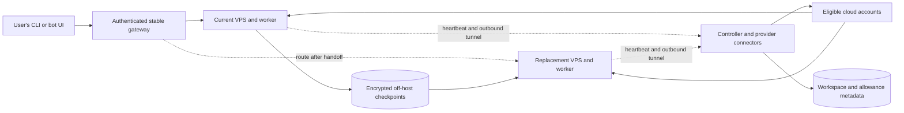

**Research and build proposal: automatic free-compute routing for coding agents and bots**

Research date: November 12, 2026. Research used Firecrawl searches and page retrieval, with an additional Context7 check of OpenCode's remote-server architecture. This is a feasibility investigation and proposed engineering design. No customer cloud accounts were connected, no VPS was provisioned, and no migration was tested.

The product evaluated is exactly this: a customer connects a supported coding agent or bot and their own eligible cloud accounts; the service provisions suitable compute, installs the agent, tracks remaining benefits, and restores the agent on another eligible provider before the current benefit runs out. The customer retains a stable connection and saved workspace. The proposal does not assume that we supply unlimited subsidized compute or replace the customer's agent interface.

**My judgment is that this is technically plausible for a supported set of agents and worth a constrained prototype. Its commercial viability is unproven.** The strongest differentiation is the combination of account-specific free-benefit selection, unattended provisioning, and tested agent recovery. A promise of unlimited free servers, zero signup effort, or uninterrupted live migration would exceed the evidence.

The main challenge is not creating VMs. It is maintaining an accurate model of each customer's entitlements, safely moving stateful work, and making several cloud-account authorizations tolerable. Existing infrastructure tools demonstrate much of the provisioning and recovery machinery, but do not establish demand for this particular product. [SkyPilot managed jobs](https://docs.skypilot.ai/en/stable/examples/managed-jobs.html).

**The free-compute supply is useful but uneven.** These are the strongest mainstream offers verified in this investigation; this is not an exhaustive catalogue of regional promotions or negotiated credits.

| Provider or offer | Verified benefit | Limitation that matters to this product | Proposed role |
| --- | --- | --- | --- |
| Oracle Always Free ARM | 1,500 OCPU-hours and 9,000 GB-hours each month, equivalent to 2 OCPUs and 12 GB continuously; 200 GB combined boot/block storage | Home region only; available capacity is not guaranteed; idle resources can be reclaimed; ARM compatibility required | Primary recurring free destination for compatible workloads. [Official limits](https://docs.oracle.com/en-us/iaas/Content/FreeTier/freetier_topic-Always_Free_Resources.htm) |
| Oracle Always Free AMD | Up to two micro instances; each has 1 GB RAM and a small fractional CPU allocation | Too small for many coding builds and browser-heavy bots | Optional lightweight connector or small workload; not an equivalent replacement for the ARM host. [Official shapes](https://docs.oracle.com/en-us/iaas/Content/FreeTier/freetier_topic-Always_Free_Resources.htm) |
| Google Cloud recurring Free Tier | One e2-micro's worth of monthly hours in three eligible US regions; 30 GB-months standard persistent disk; 1 GB eligible outbound transfer | Small capacity; strict disk/region/egress rules; networking can add charges | Conditional lightweight fallback, not a universal replacement. [Free Tier documentation](https://docs.cloud.google.com/free/docs/free-cloud-features) |
| Google Cloud trial | $300 welcome credit over 90 days for eligible new customers | Signup starts the clock; identity/payment verification; trial ends without upgrade | Temporary larger host while eligible. [Trial documentation](https://docs.cloud.google.com/free/docs/free-cloud-features) |
| AWS new-customer Free account plan | $100 signup credit, up to $100 additional earned credits; plan lasts up to six months or credit exhaustion | Not a recurring free EC2 entitlement; account closes at expiry; plan and service restrictions apply | Useful trial host with a particularly promising credit-status API. [Current plan documentation](https://docs.aws.amazon.com/awsaccountbilling/latest/aboutv2/free-tier-plans.html) |
| Azure new-customer benefits | $200 for 30 days; selected VM allocations for 12 months, including 750 hours each of B1s, B2pts v2, and B2ats v2 | Continuing after the initial trial requires an upgrade; ancillary services and overages can be charged | Later connector after end-to-end billing validation. [Offer](https://azure.microsoft.com/en-us/pricing/purchase-options/azure-account), [upgrade and charging behavior](https://learn.microsoft.com/en-us/azure/cost-management-billing/manage/avoid-charges-free-account) |

An important factual conflict surfaced: OpenClaw's Oracle guide still advertises up to 4 OCPUs and 24 GB, while Oracle's own documentation currently specifies 2 OCPUs and 12 GB. The product should prefer the provider's official rules and the actual account's eligibility over an agent project's installation guide. Store source URLs, check dates, and versioned rules in the entitlement catalogue. [OpenClaw guide](https://docs.openclaw.ai/install/oracle), [Oracle limits](https://docs.oracle.com/en-us/iaas/Content/FreeTier/freetier_topic-Always_Free_Resources.htm).

A correctly sized recurring free VM may already cover the whole month. For example, Oracle's 1,500 OCPU-hours divided by 2 OCPUs is 750 hours; 9,000 GB-hours divided by 12 GB is also 750 hours. That exceeds a 31-day month's 744 hours, assuming no other usage consumes the allowance. Routine movement is therefore more relevant to expiring trials, oversubscribed allowances, failures, unavailable capacity, and changing resource requirements than to a single properly sized Oracle VM exhausting its compute allowance. This is arithmetic based on the documented allocation, not an availability guarantee. [Oracle allocation](https://docs.oracle.com/en-us/iaas/Content/FreeTier/freetier_topic-Always_Free_Resources.htm).

Google's free VM needs particular care. Its current public networking page lists in-use standard-VM IPv4 addresses at $0.005/hour with only one hour of monthly free usage. A 730-hour illustration is roughly $3.65 for that address alone after the one free hour. Do not classify a configuration as fully free simply because its CPU and disk are eligible. An IPv6-based design would need tested access to every model API, package repository, registry, and authentication endpoint; paid NAT must not quietly replace an absent free route. [Live-checked network pricing](https://cloud.google.com/vpc/network-pricing).

An idle web-service tier is a different product from an always-on VPS. For example, Render's free web services sleep after 15 minutes without inbound traffic and do not support persistent disks. They should not be interchangeable destinations for arbitrary persistent agents. [Render free-service limits](https://render.com/docs/free).

**The unattended experience begins after customer authorization.** A practical onboarding flow would ask the customer to choose a supported agent, link a repo or import selected workspace data, connect a model account/key, and authorize at least two compatible cloud accounts if they want automatic cross-provider fallback immediately. The service would then manage provisioning, installation, networking, snapshots, and handoffs.

There are two separate authorizations: permission to manage cloud infrastructure, and permission for the remote agent to use the customer's AI account and connected tools. Connecting a local CLI does not automatically grant permission to move every credential in the customer's home directory. Use explicit, agent-specific imports or a fresh remote sign-in. Reauthentication can still be required after token expiry, revocation, or a provider security challenge.

| Step | Can the product handle it? | Realistic user involvement |
| --- | --- | --- |
| Find compatible offers and inspect available benefits | Mostly, with provider-specific connectors | Fill gaps that the provider does not expose through a supported API |
| Create a new cloud account | Guide the process | User completes identity, card, phone, CAPTCHA, and applicable terms |
| Authorize infrastructure management | Prefilled provider flow or bootstrap template | User approves the requested access once per provider |
| Create VM, disk, network and firewall | Yes, through supported APIs | No Linux or SSH configuration needed |
| Install a supported agent | Yes | Choose version and approve supported credentials/imports |
| Connect model account, GitHub, messaging apps | Can guide supported OAuth/device-code/key flows | User signs in and grants access |
| Move saved state to another connected eligible provider | Yes, for supported adapters | Usually none during a planned, validated handoff |
| Continue a raw shell or arbitrary running process unchanged | Not a general MVP capability | Process restarts and client reconnects must be expected |
| Produce additional free benefits after all eligible accounts are exhausted | No | Wait for a recurring reset, connect another legitimate eligible offer, or explicitly allow paid compute |

AWS has an established third-party delegation model: the customer creates a scoped IAM role and the SaaS assumes it using temporary credentials with a customer-specific ExternalId. A prefilled CloudFormation flow can simplify creating that role. The product should not ask for the customer's root password or enroll accounts in our AWS Organization. Joining Organizations is one of the documented triggers that automatically upgrades a Free account plan to Paid. [Third-party roles](https://docs.aws.amazon.com/IAM/latest/UserGuide/id_roles_common-scenarios_third-party.html), [CloudFormation onboarding example](https://aws.amazon.com/blogs/apn/generating-custom-aws-cloudformation-templates-with-lambda-to-create-cross-account-roles/), [Free plan upgrade triggers](https://docs.aws.amazon.com/awsaccountbilling/latest/aboutv2/free-tier-plans.html).

Oracle offers a Deploy to Oracle Cloud button that opens a prefilled Terraform stack wizard. It still requires console login and confirmation. OCI also documents cross-tenancy delegation through matching Define/Endorse/Admit policies, with region-subscription requirements. The first engineering spike must validate the exact minimum compute/network/storage policies and eligibility on free tenancies. A guided, compartment-scoped API-signing-key connection is a possible fallback; a public SaaS should not pretend that Oracle already has the same simple OAuth connection flow as every other provider. Delegated access must survive loss of the worker VM. [Oracle deployment button](https://docs.oracle.com/en-us/iaas/Content/ResourceManager/Tasks/deploybutton.htm), [cross-tenancy policies](https://docs.oracle.com/iaas/Content/Identity/policieshow/iam-cross-domain.htm).

Google supports Workload Identity Federation and service-account impersonation, which provide building blocks for avoiding permanent downloaded account keys. The customer must still approve project permissions and billing setup. This research did not validate a complete novice-friendly GCP onboarding flow. [Workload Identity Federation](https://docs.cloud.google.com/iam/docs/workload-identity-federation).

DigitalOcean's OAuth API is a useful model of a smoother Connect Provider experience: it supports browser authorization and scoped access, including PKCE for public clients. Its current promotional-credit amount was not adequately verified here, so it should not be advertised as a recurring free destination based on old referral posts. [DigitalOcean OAuth](https://docs.digitalocean.com/reference/api/oauth/).

Trial clocks are a structural onboarding problem. Creating three accounts on the same day can start all three expiry windows together, even if the service only uses one host at a time. Just-in-time signup can preserve more useful runway, but requires a human signup step later. Fully unattended switching requires eligible accounts already authorized; the product cannot promise both no later signup work and the sum of every trial's full duration. [Google trial timing](https://docs.cloud.google.com/free/docs/free-cloud-features), [AWS plan timing](https://docs.aws.amazon.com/awsaccountbilling/latest/aboutv2/free-tier-plans.html).

**Usage tracking can be automated, but it needs evidence and estimates rather than a single universal counter.** AWS's GetAccountPlanState exposes plan type, plan status, expiry, and remaining credit amount. That is direct evidence for a credit-aware connector. It does not establish that every cloud exposes the same fields or updates them instantly. [AWS API](https://docs.aws.amazon.com/aws-cost-management/latest/APIReference/API_freetier_GetAccountPlanState.html).

Maintain three kinds of information: provider-reported balances and timestamps; estimates from the resources the service actually launched; and verified benefit rules such as region, shape, signup date, reset date, credit expiry, eligible services, and plan type. Display when information is stale or incomplete. An unverified offer should not qualify for automatic free-only placement.

Costs must include VM runtime, disk, IP addresses, egress, backups, object requests, monitoring, taxes where applicable, and the overlap needed during migration. Existing workloads in the same billing account can consume the same benefit. The connector needs enough account-level visibility to detect this, without assuming the service controls everything in that account.

Billing reports can lag. AWS Cost Explorer documents updates at least every 24 hours, sometimes later, and charges $0.01 per paginated API request. Polling it every minute is both costly and insufficient as an immediate shutoff mechanism. Use the dedicated Free Tier API where suitable, runtime metering, periodic reconciliation, and conservative migration reserves. [AWS Cost Explorer behavior](https://docs.aws.amazon.com/cost-management/latest/userguide/ce-what-is.html).

Google now documents spend-cap budgets for specific API-based services, but its eligible list does not include Compute Engine, and it explicitly says persistent compute/storage resources keep accruing charges. This does not provide a universal VM spending brake. [Spend-cap scope and limitations](https://docs.cloud.google.com/billing/docs/how-to/budgets-spend-caps).

For free-only mode, proposed admission rules are: all necessary resource types have verified coverage; the workload fits available capacity and architecture; remaining benefits cover runtime plus a migration reserve; monitoring information is sufficiently current; and cleanup is supported. If a rule fails, wait or pause rather than launch a paid fallback. This reduces risk but does not create a blanket $0 billing guarantee on an upgraded pay-as-you-go account. Native provider no-charge trial plans are a stronger boundary where available.

The routing decision should estimate the earliest limiting event among credit depletion, benefit expiry, VM-hour exhaustion, and constrained storage/network usage. Migrate early enough to cover billing uncertainty, destination boot time, data transfer, health checks, and old-resource cleanup. A fixed 95% threshold is not adequate across all providers and workloads.

**The migration promise should be a stable workspace with checkpoint-and-resume.** The domain, logical workspace ID, and user permissions stay stable. Underlying connections can drop briefly and reconnect. A stable DNS name alone does not keep a TCP connection, a terminal process, or an in-memory browser alive.

OpenCode is a plausible first coding-agent adapter because its current documentation exposes headless serving, session export/import, and credential migration. A separate full-workspace backup is still needed; a conversation export is not a backup of all uncommitted code, databases, tools, and files. Pin the exact agent version and test imports against it. [OpenCode commands](https://opencode.ai/docs/cli/commands/), [remote-server architecture](https://opencode.ai/v1/docs/server/).

OpenClaw is a plausible second adapter because its machine-migration guide describes stopping the gateway, making a verified backup, restoring the state and workspace, checking ownership/configuration, and restarting. Its backup includes sensitive authentication and channel data, so encrypt it and treat it as a credential-bearing asset. This documents a migration route, not a guarantee that all external sessions survive every move. [OpenClaw migration guide](https://docs.openclaw.ai/install/migrating).

Proposed planned-handoff sequence:

1. Select an eligible destination that meets resource, architecture, and account constraints; reserve enough source allowance for the operation.
2. Provision and validate the destination runtime, without starting a second active copy of the user's agent.
3. Stop admitting new agent work and let supported work reach a safe stopping point.
4. Flush application state; use a database-consistent backup rather than copying a changing SQLite database blindly.
5. Encrypt and upload the final workspace/state checkpoint to storage independent of the departing account.
6. Stop or fence the source worker; confirm it can no longer act before enabling the replacement.
7. Restore and verify the destination; map the logical workspace/session to any new underlying agent session ID.
8. Move the gateway route and reconnect the client; verify files, history, agent health, and supported integrations.
9. Remove or explicitly retain the old VM, IP, disks, snapshots, and other resources according to the user's policy. Check for resources still accruing charges.

An unexpected shutdown differs from a planned handoff: only the last completed off-host checkpoint is available. Publish a recovery-point target and recovery-time target after measurement. For arbitrary external actions, a crash can leave uncertainty about whether an email, payment, PR, or deployment completed. Do not promise exactly-once execution; reconcile state before repeating uncertain actions. A database lease alone does not disable a disconnected old process unless the runtime or an enforced network boundary honors it.

Moving from ARM to AMD64 or back also requires compatible runtime images and rebuilding architecture-specific dependencies. Do not copy node_modules, virtual environments, or native binaries as if they were universally portable. A workload needing 8 GB cannot fall back to a 1 GB VM just because that VM is free. Browser profiles, external OAuth, hardware-bound credentials, desktop access, and separately purchased cloud-browser quotas require explicit compatibility testing.

**A small hosted controller plus lightweight per-VM workers is a reasonable first architecture.** This is a proposed design, not a framework benchmark.

An implementation could use a TypeScript web interface and small CLI launcher, a Python API/worker service, PostgreSQL for durable operation state, object storage for encrypted checkpoints, and Docker plus cloud-init for reproducible workers. Native provider SDK adapters should expose a small common contract: inspect entitlement, discover compatible capacity, provision, check health, stop/fence, and delete resources. Agent adapters should separately expose install, authenticate, pause, checkpoint, restore, resume, and verify. Their separation prevents provider-specific billing logic from leaking into every agent integration.

The controller must live independently of the customer's current free host and retain sufficient delegated access to recover after that host is lost. Workers can connect outward through authenticated tunnels so users need not open public management ports. Use one customer per VM initially; keep cloud-management credentials outside the coding agent's environment; provide revocation, an activity log, export, and deletion. Snapshot storage and the gateway are operating costs borne by the product even when the customer's VM usage is free.

Minimum metadata includes customer/account/workspace IDs, provider and home region, authenticated permission scope, offer type and eligibility evidence, benefit start/end/reset times, reported balance and timestamp, estimated usage, current resource IDs, architecture and minimum resources, agent version, snapshot checksums and locations, and durable migration phase. Never store secrets in ordinary event logs.

Use idempotent, persisted operations for provisioning and cleanup so retries cannot create duplicate VMs or lose track of volumes. Pin runtime images and sign releases. Policy decides where and when to launch; a language model may explain status but should not be the authority deciding whether a paid resource is allowed.

SkyPilot is worth evaluating as an infrastructure component, but it already has its own operational model and job controller. Its documentation establishes automatic recovery and checkpoint-based restart; it does not establish plug-in support for this product's specific Free Tier rules, customer onboarding, or arbitrary agent-session portability. For two cloud connectors, a narrow native-SDK implementation may be easier to reason about. Reconsider reuse when expanding provider count. [SkyPilot managed jobs](https://docs.skypilot.ai/en/stable/examples/managed-jobs.html).

**The competitive field contains substantial adjacent products.** I did not verify an exact consumer-ready service combining user-owned free-benefit aggregation, automatic provisioning, and allowance-triggered migration of supported coding agents among providers. This is a bounded research finding, not proof that no such product exists.

| Product | Verified overlap | Difference from the proposed product |
| --- | --- | --- |
| SkyPilot | Cross-cloud resource orchestration, cost/capacity selection, managed-job recovery | Application checkpointing and account-specific free-benefit routing remain product work. [Docs](https://docs.skypilot.ai/en/stable/examples/managed-jobs.html) |
| CloudPloy | Agent-facing MCP deployment, AWS EC2 in customer accounts, existing SSH hosts | Primarily deploys applications; its free control-plane plan does not mean free compute, and allowance-triggered cross-provider agent migration was not verified. [Product](https://cloudploy.com/) |
| Cloudish | Agents can acquire a key and deploy containers through APIs; prepaid spend boundary and persistent volumes | Supplies its own paid compute rather than routing users' cloud benefits. Its docs currently describe a small $0.10 initial grant, subject to availability. [Product docs](https://www.cloudish.ai/llms.txt) |
| Coolify | Deploys applications and services on user-controlled servers; deployment and backup automation | Free-benefit selection and automatic cross-cloud agent-state handoff were not established by the reviewed materials. [Product](https://coolify.io/) |
| MausBot Cloud | Always-on hosting for MausBot; Starter is currently $15/month, with separate model usage | Native, integrated convenience is a strong alternative for customers using only MausBot. [Plans](https://mausbot.com/pro) |
| OneClickClaw | Managed Hermes hosting, automatic provisioning, backups and a trial | Conventional hosted-agent convenience rather than the verified free-benefit-routing workflow. [Product](https://oneclickclaw.io/hermes) |

Multy is also an analogous open-source abstraction: its README describes cloud-agnostic deployment and changing providers through configuration. This investigation did not establish its present maintenance status or suitability as a dependency, so it is an architectural reference rather than a recommended foundation. [Repository](https://github.com/multycloud/multy).

Some search results were stale or incomplete. A previously indexed Runware free-OpenClaw page returned a 404 when retrieved; it was excluded from verified competitors. Firecrawl could not retrieve the Reddit discussion selected for independent customer-pain evidence, so the report does not treat that discussion as verified demand evidence.

**The business case is a hypothesis with a specific audience.** The clearest prospective users are people experimenting with several open-source agents, students or hobbyists with legitimate credits, and developers operating bots for clients. A single-agent customer can choose that project's native cloud product, while an experienced infrastructure operator can already script provisioning. Our service must make account connections, benefit selection, and repeatable recovery sufficiently easier to justify another trusted vendor.

Adjacent paid offerings demonstrate that companies are selling always-on agent hosting. They do not demonstrate how many users will authorize multiple cloud accounts, whether users primarily seeking $0 hosting will pay a management fee, or whether migration happens often enough to drive retention. No customer interviews, verified competitor revenues, or reliable market-size estimate were obtained in this research. [MausBot plans](https://mausbot.com/pro), [OneClickClaw](https://oneclickclaw.io/hermes).

The defensible work would be the tested provider/agent compatibility matrix, verified entitlement rules, successful recoveries, and distribution through integrations with agent projects. A directory of free offers or a dashboard alone would be easier to copy.

An initial business model could offer a free local/open-source connector and charge for the hosted controller, automatic off-host backups, multi-provider policies, and managed recovery. A $5–$9 monthly management plan is a price experiment, not a market-supported recommendation. Keep model bills, cloud charges, and the management fee visibly separate. Provider incentives may change, so a sustainable product cannot budget its own ongoing operation on unending trial grants.

**Provider policies are a material dependency of the exact credit-switching model.** Oracle permits one Free Trial or Always Free account per person and prohibits attempts to create multiple free accounts. AWS promotional-credit terms prohibit selling/transferring credits and say credits may be voided if AWS determines an account was created solely to obtain them. Keep benefits inside each customer's own account and obtain confirmation of relevant program terms before publicly promising a credit-hopping product. This is a documented business constraint, not a finding that ordinary authorized multi-cloud management is prohibited. [Oracle eligibility](https://www.oracle.com/cloud/free/faq/), [AWS promotional-credit terms](https://aws.amazon.com/awscredits/).

Support for an agent's CLI also does not establish permission to resell its subscription, pool users' model entitlements, or use every authentication method on hosted servers. Model authentication and usage restrictions need verification for each official integration; begin with a supported customer-owned API key path when necessary. Moving a host does not reset model, cloud-browser, messaging, or third-party tool limits.

**The first build should prove the user's central promise, including actual cross-provider movement.** It should not stop at a one-cloud deployment dashboard.

| Stage | Concrete work | Evidence required before expanding |
| --- | --- | --- |
| Provider and policy spike | Validate AWS Free plan delegated access and credit API; validate OCI compartment-scoped provisioning, capacity errors, entitlement checks and revocation; clarify applicable offer terms | Two legitimate test accounts can be managed without root credentials, auto-upgrades, or untracked resources |
| Portable workspace prototype | One OpenCode version, one repo, explicit credentials, fixed workspace layout, off-host checkpoint, authenticated gateway, two compatible destinations | A manually triggered cross-provider move preserves uncommitted tracked/untracked work and conversation, with measured interruption |
| Automatic routing | Provider balance/status reconciliation, resource meter, expiry scheduler, free-only admission, reserve calculation, capacity backoff and cleanup | A deliberately shortened test allowance triggers the same handoff automatically; no paid fallback is silently used |
| Failure recovery | Repeated checkpoints, worker-loss detection, old-worker fencing, restore validation, uncertain-action handling | Forced host loss recovers from the last valid snapshot; stale workers cannot resume acting unnoticed |
| Small public pilot | Guided cloud connection, clear status, export/delete, alerts only when action is needed, support instrumentation | Real customers complete setup, retain usage and trust recovery enough to pay |
| Expansion | OpenClaw adapter, then further clouds and projects according to compatibility evidence | Each added provider/agent pair passes the migration and billing checks |

AWS plus OCI is a reasonable first pair to investigate: AWS has documented credit-status fields and OCI has substantial recurring compute. It is a hypothesis contingent on actual delegated access, sufficient destination capacity, service eligibility, and architecture compatibility. Do not advertise the pair as production-ready before the spike. If a destination is unavailable, the product must show that state and pause when necessary.

MausBot and OpenBot should be evaluated individually after the portable coding-agent path works. OpenBot's reviewed Kubernetes instructions require AMD64 nodes plus additional services and licensing setup, which illustrates why an arbitrary popular bot is not automatically a drop-in workload on every free ARM VM. A catalogue should label support as tested migration, restart-only, or unsupported. [OpenBot deployment requirements](https://github.com/CopilotKit/OpenBot#deploy-on-kubernetes).

Suggested engineering acceptance cases are: planned handoff at a safe point; expiry with no destination capacity; stale/missing billing data; source death before the final checkpoint; controller restart mid-migration; revoked cloud or model authorization; corrupt checkpoint; ARM/AMD64 incompatibility; a disconnected old worker; no eligible allowance anywhere; and orphaned IP/disk charges after migration. These are proposed validation cases, not completed tests.

For customer validation, recruit ten people who already want to run a named agent remotely. Observe the connection process rather than only collecting waitlist emails. Measure authorization abandonment, first successful agent task, support time per activation, seven-day return usage, available second-host eligibility, real reasons to migrate, recovery success, and willingness to pay. Example pilot targets could be eight of ten reaching a useful task and at least three paying to continue, but those are decision thresholds to choose, not industry benchmarks.

A deliberately induced migration is essential because real trials may not expire during a short pilot. Show users the actual interruption and recovery behavior. If they accept setup only when promised indefinite free hosting, or rarely possess a compatible fallback, that would weaken this specific product even if they like the demo.

The immediate next deliverable should be a measured technical spike: connect two real eligible cloud accounts with limited permissions, launch one supported agent, modify a workspace, force an allowance-triggered handoff, and verify its restored state through the same logical connection. That result would resolve more uncertainty than building a large interface or adding ten untested provider logos.
